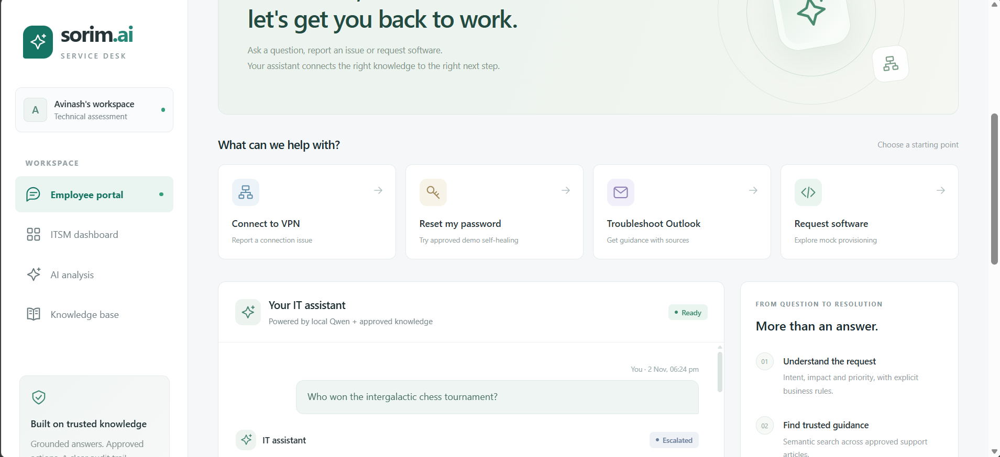
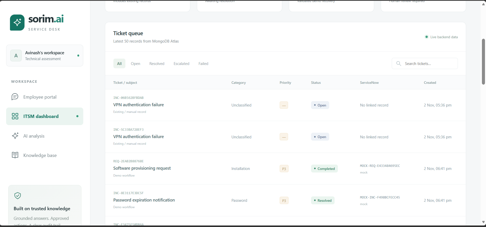
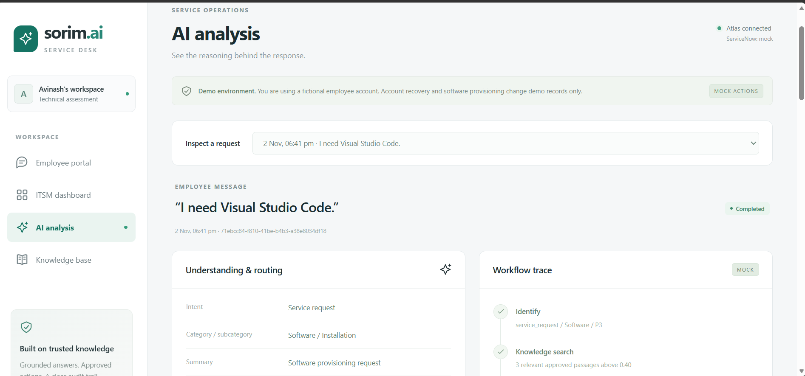
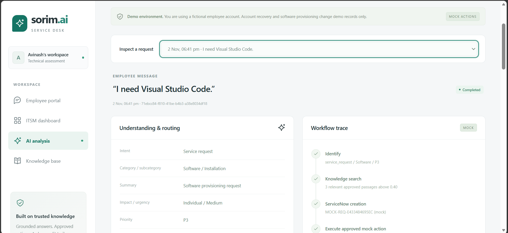
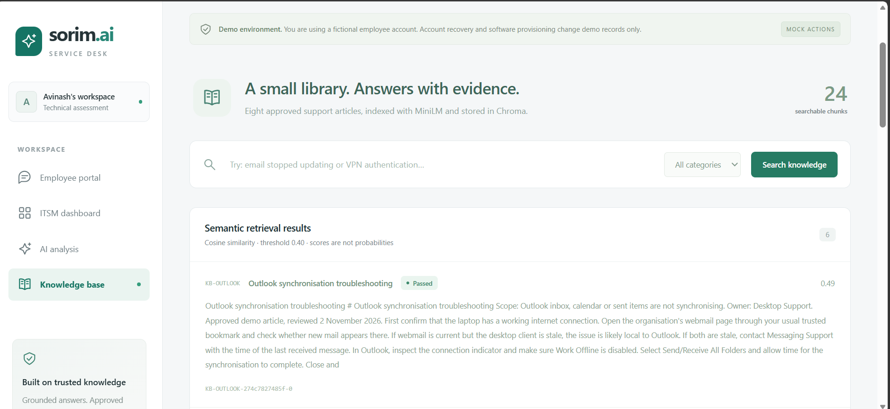

# AI ITSM Helpdesk Automation

An AI-powered IT service management prototype by **Avinash**, built for the Sorim.AI technical assessment. Employees can describe an issue, ask a support question or request software through a React portal. FastAPI coordinates local AI models, approved knowledge, MongoDB Atlas records and controlled workflows.

**Demo boundary:** ServiceNow uses a persistent mock API by default. Password recovery, account unlock and software provisioning change fictional records only. They do not change real accounts or install software. The application uses a fixed demo employee and has no enterprise authentication.

## Main capabilities

| Capability | Implementation |
| --- | --- |
| Intelligent ticket intake | Validates Qwen classification proposals and applies explicit rules for intent, category, impact, urgency, priority and assignment group. |
| Self-healing workflows | Allowlisted mock password reset and account unlock, with before/after checks, audit events and ITSM status updates. |
| Knowledge management and RAG | Eight sample support articles, overlapping chunks, CPU MiniLM embeddings, persistent Chroma retrieval and source citations. |
| Employee self-service | Chat, an ITSM dashboard, AI analysis with workflow/audit details, and a searchable knowledge base. |
| Software provisioning | Approved VS Code catalogue request, mock ServiceNow request, fictional device update and read-back validation. |

Qwen selects evidence sentences from actual retrieved passages. The backend validates the selection and displays the original sentences with citations. Invalid classification proposals use an explicitly labelled business-rule fallback; unsupported questions offer human escalation.

## Technology stack

- **Frontend:** React, TypeScript, Vite, CSS.
- **Backend:** Python 3.12, FastAPI, Uvicorn, Pydantic, HTTPX.
- **Operational storage:** MongoDB Atlas through asynchronous PyMongo.
- **Local AI:** `Qwen/Qwen2.5-1.5B-Instruct`, Transformers, PyTorch and Accelerate.
- **Retrieval:** `sentence-transformers/all-MiniLM-L6-v2` on CPU; persistent Chroma with cosine similarity.
- **Development:** pytest, pytest-asyncio, ESLint, Python dependency files and npm lockfile.

```text
React portal -> FastAPI -> validated classification and workflow policy
                          |-> MiniLM -> Chroma -> Qwen evidence selection
                          |-> MongoDB Atlas: tickets, chat, requests and audit
                          |-> ServiceNow adapter -> persistent mock API
                          `-> approved mock action -> state validation
```

## Setup

The existing laptop setup uses Python 3.12.10, Node.js 26.13.0 and an NVIDIA RTX 3050 Laptop GPU with 4 GB VRAM. Reuse its working virtual environment and installed models. For a new checkout:

1. Create the Python environment and install backend dependencies:

   ```powershell
   py -3.12 -m venv backend/.venv
   & .\backend\.venv\Scripts\python.exe -m pip install -r backend/requirements.txt
   ```

2. Install a PyTorch build suitable for your CPU/CUDA environment. The recorded laptop environment uses `torch==2.14.1+cu126`. The full installed snapshot is in `backend/requirements-lock.txt`; its CUDA wheel needs the matching package source when recreating that environment.
3. Install the frontend from its lockfile:

   ```powershell
   Set-Location frontend
   npm.cmd ci
   Set-Location ..
   ```

4. For a **new checkout only**, copy `backend/.env.example` to `backend/.env` and fill in backend settings. Preserve an existing working `.env`; never commit it.
5. Cache both model repositories listed above before startup. Model weights are excluded from Git. Normal startup defaults to local cached files. Atlas requires internet access and a permitted client network address.

### Environment variables

| Variable | Purpose |
| --- | --- |
| `MONGODB_URI_TEMPLATE` | Atlas URI template containing the literal `<db_password>` placeholder. |
| `MONGODB_PASSWORD` | Backend-only Atlas password; URL-encoded by the configuration loader. |
| `MONGODB_DB` | Database name; defaults to `helpdesk`. |
| `SERVICENOW_MODE` | `mock` by default; `real` requires an instance and integration configuration. |
| `MODELS_ENABLED` | `true` for local model loading. |
| `HF_LOCAL_FILES_ONLY` | `true` to use cached models without downloads at startup. |

The placeholder-only [backend/.env.example](backend/.env.example) also documents the optional real ServiceNow URL, credentials, assignment-group sys_ids and VS Code catalogue item ID. Keep all credentials in the backend. An optional frontend `VITE_API_BASE_URL` can change the API address, but must never contain credentials.

### Start the application

From the project root, start one backend:

```powershell
& .\backend\.venv\Scripts\python.exe -m uvicorn main:app --app-dir backend --host 127.0.0.1 --port 8000
```

In another terminal:

```powershell
Set-Location frontend
npm.cmd run dev -- --host 127.0.0.1 --port 5173 --strictPort
```

- **Portal:** http://127.0.0.1:5173 (or the existing http://localhost:5173 Vite address).
- **API documentation:** http://127.0.0.1:8000/docs.
- **Database/model status:** http://127.0.0.1:8000/api/system.

Models and Chroma run inside the backend; no separate model or vector-database server is required. Wait for model startup, reuse existing servers and use a single backend worker on a 4 GB GPU. Development can add `--reload`, which reloads models when Python files change.

## Demo scenarios

| Employee message | Expected workflow |
| --- | --- |
| “My VPN is not connecting.” | Network/VPN incident, Individual/High, P2, Network Support, retrieved guidance and a mock incident reference. |
| “My password has expired.” | Approved demo password recovery, account-state validation, audit trail and mock incident update. |
| “How do I troubleshoot Outlook synchronisation?” | Qwen-selected evidence with KB-OUTLOOK sources; no automatic incident. |
| “I need Visual Studio Code.” | Approved service request, mock provisioning and validated fictional device inventory. |
| An unsupported question | Honest insufficient-knowledge response and an explicit escalation option. |

Account unlock is also supported. Unapproved software requires human review. Repeating a healthy account or device workflow is a documented no-op rather than an unnecessary mutation.

For a fresh demonstration, stop the backend and run:

```powershell
& .\backend\.venv\Scripts\python.exe backend/scripts/reset_demo.py --confirm-demo-reset
```

The reset targets labelled demo records and preserves original/manual tickets. See the [demo guide](docs/DEMO_GUIDE.md) for the full presentation sequence.

## Application Screenshots

Explore the four application screens through these real captures. ServiceNow references, account recovery and software provisioning shown here belong to the labelled demo environment.

[Employee portal](#employee-portal-and-chatbot) · [ITSM dashboard](#itsm-dashboard) · [AI analysis](#ai-analysis-and-workflow-trace) · [Knowledge base](#knowledge-base-and-semantic-search)

### Employee Portal and Chatbot

Self-service shortcuts for VPN, password recovery, Outlook and software requests, alongside a chatbot conversation showing an escalated unsupported question.



### ITSM Dashboard

The ticket queue brings together existing records and demo workflows, with category, priority, status and clearly labelled mock ServiceNow references. This capture includes a completed software request and a resolved password incident.



### AI Analysis and Workflow Trace

A completed Visual Studio Code request is shown with its service-request classification, software category and mock workflow trace.



<details>
<summary>View classification and workflow details</summary>

The additional view shows individual impact, medium urgency, P3 priority, retrieved knowledge and mock ServiceNow request creation.



</details>

### Knowledge Base and Semantic Search

The knowledge screen shows the approved support library's search interface and retrieved Outlook passages, including article IDs and cosine similarity scores. The interface explicitly distinguishes similarity scores from probabilities.



## Mock integrations and limitations

- **ServiceNow:** the demonstrated API is a labelled mock with records persisted in Atlas. A configurable real adapter exists, but no real-instance validation is claimed. Real-mode configuration is instance-specific; demo account actions never resolve real account changes.
- **Password recovery/account unlock:** fixed fictional employee only; no real password is generated or changed.
- **Provisioning:** changes a fictional device inventory; no executable download or physical software installation.
- The software catalogue is static and preapproved; there is no manager-approval UI or full approval engine.
- English routing patterns, a small curated corpus and an uncalibrated 0.40 retrieval threshold limit coverage. Similarity is not a correctness probability; evidence selection can still be incomplete or irrelevant.
- No enterprise sign-in, RBAC, distributed job queue or multi-worker GPU serving. Bind the prototype to loopback rather than exposing it publicly.
- Database, validation or integration failures must not be described as successful completion. Partial cross-system results may require reconciliation.

## Project documentation

- [Technical guide](docs/TECHNICAL_GUIDE.md): architecture, API reference, model configuration, failure handling and integration details.
- [Demonstration guide](docs/DEMO_GUIDE.md): presentation sequence and recovery notes.
- [Assessment coverage](docs/REQUIREMENTS_MATRIX.md): requirements mapped to implementation.
- [Recorded verification](docs/VERIFICATION.md): historical checks and their limits; no application checks were rerun for publishing.

Source, sample knowledge, tests, dependency/version files and lockfiles are included. Credentials, virtual environments, model weights, runtime databases, private logs, caches, temporary backups and generated archives are excluded.
