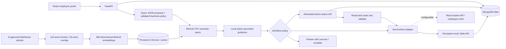

# Avinash's AI ITSM Helpdesk

A local React + FastAPI prototype for the Sorim.AI technical assessment. It extends the original Atlas-backed ticket API and preserves its existing ticket records. The specification was checked against `AI_ITSM_Helpdesk_Technical_Hackathon_Assessment (1).pdf` supplied by Avinash.

The application connects employee messages to classification, real semantic retrieval, local Qwen responses, ITSM records and approved demo actions. **ServiceNow is mocked by default. Every password, account and device operation is a simulation.** The portal uses the fictional employee `demo-avinash`; there is no production authentication.

## Run on this laptop

Use two PowerShell terminals from the project root. Dependencies and both Hugging Face models are already installed; no reinstall is needed. Check for an existing listener first and reuse the VS Code terminals if they are running.

```powershell
netstat -ano | Select-String ':8000|:5173'
```

Backend:

```powershell
& .\backend\.venv\Scripts\python.exe -m uvicorn main:app --app-dir backend --reload --host 127.0.0.1 --port 8000
```

Frontend, in the other terminal:

```powershell
Set-Location frontend
npm.cmd run dev -- --host 127.0.0.1 --port 5173 --strictPort
```

`npm.cmd` works when PowerShell's execution policy blocks `npm.ps1`; changing the machine's execution policy is unnecessary. If the original Vite terminal already serves `localhost`, keep using that address.

- Portal: http://localhost:5173 (or http://127.0.0.1:5173 with the command above).
- Backend readiness/details: http://127.0.0.1:8000/api/system
- Swagger API documentation: http://127.0.0.1:8000/docs

Wait for `Application startup complete` and `ai.status = ready`. A single backend process retains both models. **Do not start multiple Uvicorn workers** on a 4 GB GPU. Reload restarts the model process when Python files change; omit `--reload` during the presentation for a steadier demonstration.

## Fresh setup

Tested environment: Windows, Python 3.12.10, Node 26.13.0, npm 11.20.0, NVIDIA RTX 3050 Laptop GPU (4 GB), 16 GB RAM. Frontend versions and the existing TypeScript 6.0.3 / minimatch 11.0.3 override remain in `frontend/package.json` and `package-lock.json`.

1. Create `backend/.venv` with Python 3.12, if it does not exist.
2. Install a CUDA-compatible PyTorch wheel for the laptop. The verified environment uses `torch==2.14.1+cu126`; keep the working installation. CPU inference is also supported, with higher latency and memory use.
3. Install direct dependencies and the frontend lockfile:

```powershell
& .\backend\.venv\Scripts\python.exe -m pip install -r backend/requirements.txt
Set-Location frontend
npm.cmd ci
```

`backend/requirements-lock.txt` records the complete installed Python environment, including its CUDA wheel. It is a version snapshot; the CUDA build requires its matching PyTorch package source when recreating the environment. Do not blindly replace the current working packages.

4. For a **new checkout only**, copy `backend/.env.example` to `backend/.env` and fill in backend credentials. Do not overwrite the existing `.env` on this laptop. The code uses dotenv with interpolation disabled and `quote_plus` to substitute the literal `<db_password>` placeholder in `MONGODB_URI_TEMPLATE`. Database selection defaults to `helpdesk`.
5. Ensure these models exist in the usual Hugging Face cache:

```powershell
& .\backend\.venv\Scripts\python.exe -c "from huggingface_hub import snapshot_download; snapshot_download('Qwen/Qwen2.5-1.5B-Instruct'); snapshot_download('sentence-transformers/all-MiniLM-L6-v2')"
```

Model downloads require internet access. Normal application startup uses `HF_LOCAL_FILES_ONLY=true`; there is no paid API, remote inference or training. Atlas still requires internet access and a permitted Atlas network address. `.env`, virtual environments, Chroma data, logs, build outputs and local verification artifacts are ignored by Git.

## Four screens

| Screen | What it demonstrates |
| --- | --- |
| Employee portal | Natural-language messages, real backend answers, source passages, ticket references, explicit escalation, pending/error/success states |
| ITSM dashboard | Atlas totals, open/AI-resolved/escalated tickets, latest 50 tickets, filters, software requests and automation metrics |
| AI analysis | Validated model proposal, final business-rule classification, impact/urgency/priority, heuristic retrieval score, workflow trace, before/after state, ServiceNow reference and persisted audit records |
| Knowledge base | Eight complete articles, category filters, real semantic search scores, chunk passages and article details |

Dashboard totals query all records. The ticket list is limited to the latest 50; chat/analysis history shows the latest 30 and the global audit feed the latest 200. Existing manual tickets keep their original fields and are labelled accordingly. Knowledge approval is a curated demo manifest, not a production review workflow.

## Architecture



Source layout:

```text
backend/main.py                 FastAPI routes, lifespan, adapter wiring
backend/helpdesk/config.py      Backend-only settings, unchanged URI/password approach
backend/helpdesk/domain.py      Schemas, conservative routing and business rules
backend/helpdesk/rag.py         Chunking, embeddings, Chroma, retained Qwen, source checks
backend/helpdesk/integrations.py ServiceNow adapter and persistent mock record types
backend/helpdesk/automations.py Allowlist, diagnosis, state mutation, validation and audit
backend/helpdesk/service.py     End-to-end workflow, partial failures and retry replay
backend/tests/                 Deterministic failures + optional actual retrieval test
backend/scripts/               Live verification and narrowly scoped demo reset
frontend/src/                  Four React/TypeScript screens and typed API client
knowledge-base/                Approved catalogue and eight sample articles
docs/DEMO_GUIDE.md              15–20 minute presentation and expected results
docs/VERIFICATION.md            Checks performed and remaining verification limits
```

## Models, retrieval and grounding

Qwen2.5-1.5B-Instruct is a compact open-source instruction model that supports structured proposals and can fit this laptop's GPU. MiniLM is a small open-source sentence embedder; it produces 384-dimensional vectors and stays on CPU, leaving VRAM for Qwen. Qwen uses float16 on CUDA, automatic placement, a 3 GiB GPU / 6 GiB CPU weights budget, at most 2,304 input tokens, 192 classification tokens and 128 evidence-selection tokens. Generation is deterministic, serialised and bounded with a 90-second generation deadline. CPU fallback uses float32.

`knowledge-base/catalog.json` is the approved input manifest. Articles are split into overlapping word chunks, with the article title prepended to each embedded passage. Chroma stores explicit normalised MiniLM embeddings and cosine distance in `backend/data/chroma`. Content/title/category hashes identify changed chunks; unchanged chunks are reused and obsolete chunks are removed at startup. Editing articles requires restarting the backend to update the index and Atlas metadata.

Search embeds the actual employee message, retrieves the nearest passages, and retains approved passages for the policy-recognised topic above **cosine similarity 0.40**. Qwen receives complete evidence sentences extracted from those actual passages and a bounded question. It returns a structured selection of evidence IDs. The backend validates every ID and renders only the exact original source sentences with citations. This constrained extractive answer prevents invented administrator steps, menu paths or unsupported prose from reaching the employee. The UI shows article IDs, titles, passages, chunk IDs and similarity scores. The score is an **uncalibrated retrieval heuristic**, not the probability that an answer is correct. The threshold is a transparent prototype setting, not an accuracy claim from a benchmark.

Unknown topics or insufficient retrieval abstain and offer a human ticket. Known incidents with poor evidence create an escalated ITSM record and do not automate. Invalid/unavailable model classification falls back to explicitly labelled business rules. If Qwen generation or source validation fails, the response explicitly shows retrieved excerpts rather than pretending it generated an answer. Citations are attached to the actual retrieved sentences selected by Qwen. Invalid evidence IDs, free-form model text and malformed selections are rejected. Selection can still be irrelevant or incomplete, so employees can escalate for human review.

Primary references: [Qwen model card](https://huggingface.co/Qwen/Qwen2.5-1.5B-Instruct), [MiniLM model card](https://huggingface.co/sentence-transformers/all-MiniLM-L6-v2), [Chroma collection configuration](https://docs.trychroma.com/docs/collections/configure), [ServiceNow Table API](https://www.servicenow.com/docs/r/zurich/api-reference/rest-apis/c_TableAPI.html).

## Business rules and safe demo actions

- An individual VPN incident has category Network / VPN, high urgency, priority P2 and assignment group Network Support, matching the assessment. An explicitly broad, high-urgency outage is P1; normal individual requests are P3.
- The validated model can suggest a summary; it cannot select a target, approve an action, promote impact, execute a command or create its own category.
- `password_reset` requires an explicit employee password-expiry/reset issue and retrieved `KB-PASSWORD`. It changes only `demo_users.password_expired` to false and increments `reset_count` once.
- `account_unlock` requires a locked-account issue and retrieved `KB-UNLOCK`. It changes only `demo_users.locked` to false. Reset and unlock are deliberately independent.
- `provision_vscode` requires an approved catalogue match and retrieved `KB-SOFTWARE`. It adds `vscode` only to the fictional device's `installed_software` array through the mock provisioning API.
- All actions first require a persisted demo ticket/request and an ITSM reference, diagnose current state, write an audit event before mutation, execute a named allowlisted operation, read back state, and validate the result. Already-healthy targets are a documented no-op. Resolution/completion requires successful ITSM update as well as state validation.
- Other software and application access require human review; there are no real account operations, shell commands or executable downloads.
- Employee text and retrieved passages are untrusted input. Prompts isolate them as JSON data, validate structured classification, restrict action selection in Python, validate evidence selection and redact common credential forms. Never submit credentials to this demo: redaction is best effort, not a replacement for a real DLP system.

## Storage, failures and retry behaviour

The original `tickets` collection is retained. Workflow-created tickets include `is_demo=true`, `analysis`, `sources`, `servicenow` and integration state. New supporting collections are `demo_users`, `demo_devices`, `demo_requests`, `demo_audit`, `demo_chats`, `demo_knowledge` and `demo_servicenow`. All supporting demo records are labelled. No existing ticket migration or destructive startup operation is performed.

The backend does not silently switch to an in-memory database. Atlas outages return 503 and prevent new workflows. A ticket is saved before requesting ITSM creation. Ambiguous integration errors, failed post-action validation or an unavailable audit store leave a failed/escalated workflow rather than a successful resolution. If an action validated but the ServiceNow update failed, the response shows the actual demo change and a reconciliation requirement. A final database failure means persistence cannot be confirmed and the HTTP request fails.

The client sends a stable request ID. Completed requests replay their saved response; reusing an ID with different content returns 409. An interrupted in-flight ID also returns 409 and requires review. Concurrent chat work is rejected with 429 while one local workflow is running. Automation has a separate state lock. There are no blind automatic retries of remote POST operations. This single-process prototype does not provide distributed transactions or exactly-once delivery across a real external ITSM system.

## ServiceNow modes

**Mock (default):** the adapter makes HTTP calls through the same FastAPI application's ASGI transport to the clearly named `/mock/servicenow` API. Records persist in Atlas, include `mode=mock`, and return `MOCK-INC-...` / `MOCK-REQ-...` references. They support create, get and patch. The demo automation and provisioning APIs also use HTTP routes, persist real demo state changes, and can fail independently of ITSM updates.

**Real (requires an instance and validation):** set `SERVICENOW_MODE=real`, HTTPS `SERVICENOW_URL`, backend integration username/password, and the four assignment group **sys_ids** listed in `.env.example`. Incident create/get/update uses `/api/now/table/incident`. Priority, numeric impact/urgency, summary and description are mapped. Instance dictionary choice values must be reviewed; the prototype maps common category values and leaves subcategory blank in real mode to avoid submitting display labels as invalid choices.

Approved VS Code requests additionally require `SERVICENOW_VSCODE_ITEM_ID` for an existing catalogue item and use `/api/sn_sc/servicecatalog/items/{sys_id}/order_now`. Its variable schema, fulfilment/approval process and integration user's permissions must be checked on the actual instance. Unsupported software/access requests are blocked from this configured catalogue item. There is no automatic fallback to mock on a real-mode failure.

Even in real ServiceNow mode, account/provisioning actions are **still fictional**. Real records remain in progress/awaiting human review, with work notes stating that only a demo simulation was validated; a mock action never resolves a real account incident or fulfils real installation. Real integration has adapter failure tests, but no developer instance was supplied for live validation. Use the mock for the assessment demonstration.

## API reference

| Method / path | Purpose |
| --- | --- |
| `GET /health`, `GET /health/database`, `GET /api/system` | Process liveness, Atlas connectivity, model/mode status |
| `POST /api/tickets`, `GET /api/tickets`, `GET /api/tickets/{id}` | Preserved manual ticket API, latest 50, ticket details |
| `POST /api/chat` | `{message, request_id, escalate?: false}`; server fixes the demo identity |
| `GET /api/chat/history`, `GET /api/analysis` | Persisted demo chat and structured results |
| `GET /api/dashboard` | Counts from Atlas, not fabricated dashboard values |
| `GET /api/audit?ticket_id=...` | Persisted workflow/action events |
| `GET /api/knowledge?q=...&category=...` | Full approved articles and actual semantic retrieval |
| `GET /api/catalogue`, `GET /api/requests` | Approved software and stored service requests |
| `GET /api/demo/state` | Fictional account/device state for demonstration |
| `POST /mock/servicenow/api/now/table/{incident\|sc_request}` | Create labelled persistent mock record |
| `GET/PATCH /mock/servicenow/api/now/table/{table}/{sys_id}` | Retrieve/update mock record |
| `POST /mock/automation/{password_reset\|account_unlock}` | `{ticket_id}`; requires matching approved ticket and evidence |
| `POST /mock/provisioning/vscode` | `{ticket_id}`; approved fictional provisioning only |

Swagger supplies schemas and examples. Bind to loopback only: this prototype deliberately lacks enterprise sign-in, RBAC, distributed rate limiting and public-hosting hardening. Do not expose the demo mutation routes as a production service.

## Tests and repeatable demo

From the project root:

```powershell
# Deterministic routing, API, state, failure and escalation tests (no Atlas or GPU):
& .\backend\.venv\Scripts\python.exe -m pytest -q

# Also exercise actual CPU MiniLM and on-disk Chroma in a temporary test directory:
$env:RUN_MODEL_TESTS='1'
$env:HF_HUB_OFFLINE='1'
$env:TRANSFORMERS_OFFLINE='1'
& .\backend\.venv\Scripts\python.exe -m pytest -q
Remove-Item Env:RUN_MODEL_TESTS

# With backend running and models ready: actual HTTP + models + Atlas + mock adapters.
# This CREATES labelled demo records and validates all five assessment scenarios + unlock.
& .\backend\.venv\Scripts\python.exe -X utf8 backend/scripts/verify_live.py

Set-Location frontend
npm.cmd run lint
npm.cmd run build
```

The live verifier checks real Qwen generation (it rejects excerpt-only fallback), actual sources, account/device validation, ITSM retrieval/status, retry replay and preservation of existing manual tickets. It writes an ignored `artifacts/live-verification.json`. Unit tests deliberately inject retrieval, database, audit, validation and integration failures using test doubles; those outcomes are not represented as live outage experiments.

For a fresh demo, stop the backend and run:

```powershell
& .\backend\.venv\Scripts\python.exe backend/scripts/reset_demo.py --confirm-demo-reset
```

Reset uses a fixed `is_demo=true` filter and a fixed collection allowlist. It preserves all original/manual tickets, retains knowledge/index data and recreates an expired, locked fictional user with an empty fictional device inventory. It cannot delete or change real ServiceNow records and refuses real integration mode. Restart the backend, refresh the portal and follow [the demonstration guide](DEMO_GUIDE.md). Stop workflow traffic before resetting; the script is an operator tool rather than a multi-process maintenance service.

## Assessment scope and limitations

All five use cases are implemented locally. The app is a demonstrable enterprise-style prototype, not production-ready. Limitations include curated English routing patterns, an uncalibrated confidence threshold, a small sample corpus, a small model with possible classification/evidence-selection errors, simulated identity/provisioning, no enterprise authentication, no durable distributed job queue, no real ServiceNow instance verification and no multi-worker GPU support. Consult [verification evidence](VERIFICATION.md) for what was actually run and what still needs a manual browser review.
